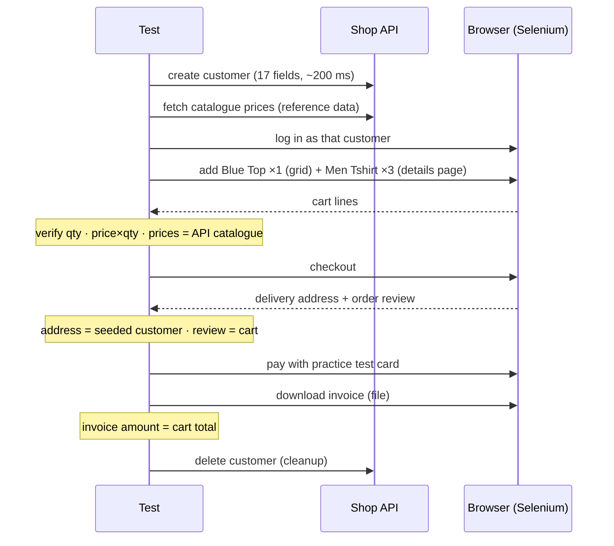
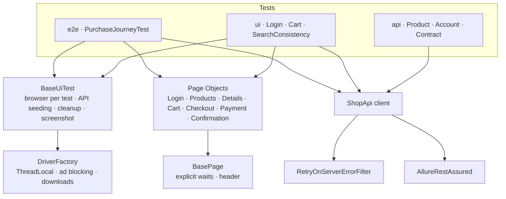

# E-commerce End-to-End Automation Framework

[](https://github.com/AishwaryaAni/ecommerce-e2e-automation-framework/actions/workflows/e2e-tests.yml)
[](https://aishwaryaani.github.io/ecommerce-e2e-automation-framework/)


A **hybrid UI + API** test framework for a live e-commerce store ([automationexercise.com](https://automationexercise.com)). It tests the full customer journey — **login → browse → cart → checkout → payment → invoice** — and uses the store's API both as a **system under test** and as a **test-data engine**, the way production-grade suites are built.

### 📊 [View the live Allure report →](https://aishwaryaani.github.io/ecommerce-e2e-automation-framework/)
Rebuilt on every push and nightly at 10:00 IST.

> Built by a QA Team Lead with 6 years of end-to-end, API and database testing on banking, assessment and SaaS products. The suite checks what I'd check by hand before signing off a release — not just "the page loaded", but **do the numbers add up across every layer?**

---

## What makes it end-to-end



Every value is verified **against an independent source**: cart prices against the API catalogue, the delivery address against the data we seeded, the order review against the cart, and the **downloaded invoice file** against the computed total.

---

## Highlights

- **Hybrid layering** — API creates and deletes customers in milliseconds; UI tests spend their time only on what they verify
- **Cross-layer data reconciliation** — UI search results must exactly equal the API's results for the same query (the UI version of reconciling a report against the database)
- **File-level verification** — the invoice is actually downloaded (per-thread download folders) and its contents asserted
- **Full API suite** — catalogue integrity, referential integrity (every product brand exists in the brand list), account lifecycle, error contract
- **Built for a real, noisy public site:**
  - ad / tracking / consent hosts **blackholed at DNS level** in Chrome (`--host-resolver-rules`) → no click-stealing interstitials
  - `EAGER` page-load strategy → no waiting on third-party scripts
  - API client **retries only 5xx/429** (never 4xx) → infrastructure noise ≠ defect
  - UI tests get **one visible retry** via a TestNG annotation transformer; API tests are never retried
- **Parallel** — API and UI layers each run multi-threaded; `ThreadLocal` drivers; every test owns its data
- **Allure** — `@Step`-level journey, every API request/response attached, screenshot + URL on failure
- **CI/CD** — GitHub Actions on push/PR/nightly → Allure on GitHub Pages + pass-rate table in the run summary

---

## Test Coverage

| Layer | Class | What it proves |
|---|---|---|
| **E2E** | `PurchaseJourneyTest` | Complete purchase with 2 products (qty 1 + qty 3): cart maths, API price parity, address parity, review = cart, payment, **invoice amount = cart total** |
| UI | `LoginTest` | API-seeded customer logs in; wrong password rejected with the right message |
| UI | `CartTest` | Add/remove lines down to an empty cart; same product twice → quantity 2, not two lines |
| UI ↔ API | `SearchConsistencyTest` ×4 | UI search results = API search results for `top`, `jeans`, `dress`, `tshirt` |
| API | `ProductApiTest` | Catalogue completeness & formats, unique ids, brands, brand referential integrity, search |
| API | `AccountApiTest` | Create → verify → read → update → delete → gone; duplicate email; wrong password can't verify or delete |
| API | `ApiContractTest` | 405 for unsupported methods, 400 for missing params, HTTP-status finding pinned |

### Manual test step → automated check

| What I'd do manually | How the suite does it |
|---|---|
| Register a test account before testing checkout | `ShopApi.seed()` — API, not 17 form fields |
| Check each cart line: price × qty = total | `CartLine.isLineTotalCorrect()` on every row |
| Cross-check the price against the product master | UI price vs `GET /productsList` |
| Confirm the address on checkout is the customer's | Compare to the seeded `User` record |
| Open the invoice and check the amount | Download, wait for the file, assert its text |
| Compare search screen vs backend data | `SearchConsistencyTest` |
| Delete the test account afterwards | `@AfterMethod` → `DELETE /deleteAccount` |

---

## API Findings 🐞

| Finding | Expected | Actual | How the suite handles it |
|---|---|---|---|
| Error status codes | 4xx in HTTP status | **HTTP 200** always; real code (400/404/405) only in the body's `responseCode` | `ApiResult.code()` reads the body; `errorsAreSignalledInBodyNotHttpStatus` pins the behaviour |
| JSON content type | `application/json` | JSON served as `text/html` | Body parsed directly, independent of the header |
| Availability | Stable responses | Intermittent **503** from the shared host | Retry filter on 5xx/429 only |

---

## Tech Stack

| Layer | Tool |
|---|---|
| Language | Java 17 (records) |
| UI | Selenium WebDriver 4 (Chrome / Firefox) |
| API | REST Assured 5 |
| Runner | TestNG 7 (parallel, groups, data providers, retry transformer) |
| Test data | DataFaker |
| Reporting | Allure 2 (TestNG, REST Assured filter, AspectJ `@Step`) |
| Build / CI | Maven · GitHub Actions → GitHub Pages |

---

## Architecture



---

## Project Structure

```
ecommerce-e2e-automation-framework
├── .github/workflows/e2e-tests.yml
├── pom.xml
└── src
    ├── main/java/com/qa/shop
    │   ├── api/          ShopApi · ApiResult · RetryOnServerErrorFilter
    │   ├── config/       ConfigReader
    │   ├── data/         UserFactory (DataFaker)
    │   ├── driver/       DriverFactory
    │   ├── models/       User · CartLine (records)
    │   ├── pages/        BasePage · Login · Home · Products · ProductDetails · Cart · Checkout · Payment · OrderConfirmation
    │   └── utils/        Money · Downloads
    └── test
        ├── java/com/qa/shop
        │   ├── base/BaseUiTest.java
        │   ├── listeners/RetryAnalyzer.java · RetryTransformer.java
        │   └── tests/
        │       ├── e2e/PurchaseJourneyTest.java
        │       ├── ui/LoginTest · CartTest · SearchConsistencyTest
        │       └── api/ProductApiTest · AccountApiTest · ApiContractTest
        └── resources/config.properties · testng.xml · testng-smoke.xml
```

---

## Getting Started

**Prerequisites:** JDK 17+, Maven 3.8+, Chrome (or Firefox).

```bash
git clone https://github.com/AishwaryaAni/ecommerce-e2e-automation-framework.git
cd ecommerce-e2e-automation-framework

mvn clean test                                  # API + UI + E2E
mvn clean test -Dsuite=testng-smoke.xml         # smoke only
mvn clean test -Dheadless=true                  # no browser window
mvn clean test -Dbrowser=firefox
mvn clean test -Dtest=PurchaseJourneyTest       # just the journey

allure serve target/allure-results              # view report (npm i -g allure-commandline)
```

> The payment step uses a public practice store and its test-card form — no real payment is ever made.

---

## Related repositories

| Repo | Focus |
|---|---|
| 🖥️ [saucedemo-selenium-framework](https://github.com/AishwaryaAni/saucedemo-selenium-framework) | Selenium + TestNG, Page Object Model |
| 🔌 [restful-booker-api-automation](https://github.com/AishwaryaAni/restful-booker-api-automation) | REST Assured, JSON schema contracts |
| 🥒 [cucumber-selenium-grid-framework](https://github.com/AishwaryaAni/cucumber-selenium-grid-framework) | BDD, Selenium Grid on Docker, cross-browser |
| 🛒 **ecommerce-e2e-automation-framework** | Hybrid UI + API end-to-end, cross-layer data checks |

## Author

**Aishwarya Anil** — Senior QA Engineer · QA Team Lead
Manual · API · Database · UI Automation

[LinkedIn](https://linkedin.com/in/aishwarya-anil20) · [GitHub](https://github.com/AishwaryaAni)
